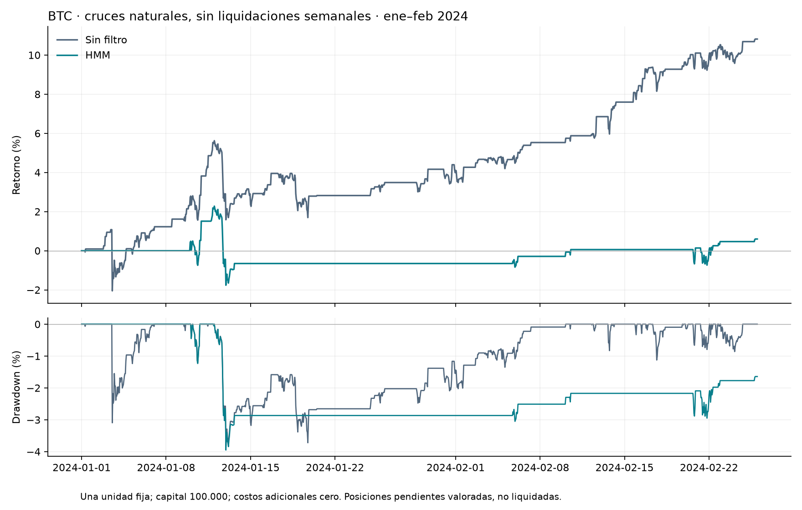

# Comparación corregida: sin liquidaciones semanales

La evaluación y la calibración sólo cierran por el cruce natural de salida. El optimizador mantiene su código y sus cierres internos. Las posiciones pueden atravesar semanas y cambios de modelo; conservan la media, timeframe, lookback y origen de historial de su entrada. Al final del dataset se valoran las posiciones pendientes, sin liquidarlas.

BTC horario de Quantiacs, ocho semanas del 1 de enero al 25 de febrero de 2024. Una unidad fija, capital de referencia 100.000 y costos adicionales cero. Mismos datos y parámetros por ventana para ambos brazos.

| Métrica | Sin filtro | HMM |
|---|---:|---:|
| Retorno total | 10.818% | 0.599% |
| Retorno anualizado | 95.417% | 3.972% |
| Máximo drawdown | -3.825% | -3.950% |
| Sharpe | 4.658 | 0.438 |
| Profit factor | 2.795 | 1.192 |
| Win rate (cerradas) | 89.157% | 92.308% |
| Exposición | 39.360% | 8.482% |
| Retorno medio por trade cerrado | 0.283% | 0.105% |
| Trades cerrados | 83 | 13 |
| Entradas candidatas | 83 | 83 |
| Entradas aceptadas | 83 | 13 |
| Entradas rechazadas | 0 | 70 |
| Posiciones abiertas al final | 0 | 0 |
| P&L total | 10818.000 | 599.000 |
| P&L realizado | 10818.000 | 599.000 |
| P&L de posiciones pendientes | 0.000 | 0.000 |

El filtro rechazó 84.34% de las entradas. En esta evaluación no mejoró ni la rentabilidad ni el drawdown; también empeoró el Sharpe. No hay evidencia para recomendar activarlo por defecto. El win rate aislado no cambia esa conclusión. La anualización de sólo 56 días no es una previsión.

## Operaciones que atravesaron semanas

Hubo **3** operaciones de referencia que cruzaron ventanas. Las tres fueron rechazadas por el filtro en este conjunto; la capacidad del brazo HMM para mantener posiciones entre ventanas también está cubierta por pruebas sintéticas.

| entry_time          | exit_time           | parameters     |   pnl |
|:--------------------|:--------------------|:---------------|------:|
| 2024-01-14 20:00:00 | 2024-01-15 05:00:00 | ('WMA', 1, 19) |  -235 |
| 2024-01-28 18:00:00 | 2024-01-29 03:00:00 | ('WMA', 1, 36) |   -60 |
| 2024-02-04 16:00:00 | 2024-02-05 07:00:00 | ('WMA', 1, 39) |  -118 |

Se verificó contra los precios y la media original de cada entrada que **todas** las salidas coinciden con el primer cruce natural posterior. Ninguna se explica por un fin de semana o por el final del test. En esta muestra ambas carteras terminaron sin posiciones pendientes, por cruces naturales; las pruebas verifican por separado el caso de una posición todavía abierta al finalizar.

## Selección histórica de estados

|   window |   regime |   number_of_trades |   average_net_return |   lower_mean_bound |
|---------:|---------:|-------------------:|---------------------:|-------------------:|
|   1.0000 |   1.0000 |            52.0000 |               0.3650 |             0.0174 |
|   5.0000 |   1.0000 |           139.0000 |               0.3492 |             0.1102 |
|   6.0000 |   1.0000 |            38.0000 |               0.5816 |             0.0115 |
|   7.0000 |   1.0000 |           148.0000 |               0.3451 |             0.1189 |

Las dos últimas columnas son porcentajes por operación, calculados sólo en calibración. Los estados son locales a cada ventana; no tienen una etiqueta económica fija. Los estados favorables fueron el 1 de las ventanas 1, 5, 6 y 7; en las demás el modelo se abstuvo. Todos los resúmenes estadísticos y económicos por estado, incluyendo distancia, pendiente, RV, ER y duración, están en [regimes.csv](results/btc_ab/regimes.csv), separados por fase.

La calibración utiliza únicamente trades naturalmente cerrados antes de su límite; purga etiquetas que cruzan fronteras y no inventa un cierre para obtenerlas. El reporte fuera de muestra atribuye cada trade a su ventana y estado de entrada, aunque cierre posteriormente. `exit_window` registra esa diferencia.

## Pruebas y trazabilidad

- **40 pruebas aprobadas**, sin fallos; [JUnit](results/tests.xml).
- Nuevas pruebas: entrada del viernes mantenida hasta el cruce posterior al lunes; cambio de media y HMM inválido sin liquidación; ausencia de cierre terminal; valoración y comisión de una posición abierta; purga de etiquetas; mismas salidas entre ambos brazos.
- [Verificación sobre trades reales](results/btc_ab/verification.json), [comparación CSV](results/btc_ab/comparison.csv), [trades entre ventanas](results/btc_ab/cross_window_trades.csv), [manifest](results/btc_ab/manifest.json).
- [Sensibilidad de estados y umbrales](results/btc_ab/calibration_sensitivity.csv): sólo calibración, sin seleccionar sobre test. Las calibraciones se solapan y no se pueden sumar como rendimientos independientes.
- [Configuración y comandos](README.md). No se modificaron los archivos fuente originales, rama ni commits.

## Diferencia respecto a la primera ejecución

El informe anterior está archivado en [RESULTADOS_CIERRES_SEMANALES.md](RESULTADOS_CIERRES_SEMANALES.md) y sus artefactos en `results/btc_ab_weekly_legacy/`. Sus métricas no describen esta política continua. Además de retirar las liquidaciones en evaluación/calibración, se eliminó la restricción añadida que excluía H5 del optimizador. Al restaurar su espacio H1–H6 cambian las configuraciones encontradas; no debe atribuirse toda diferencia con el informe viejo únicamente a la eliminación de cierres. La comparación actual A/B sí utiliza las mismas configuraciones entre sus dos brazos.

La muestra es corta y sólo cubre un activo, con ejecución al mismo cierre y costos adicionales cero. El optimizador conserva un objetivo que evalúa cierres semanales, mientras la ejecución usa cierres naturales: esa discrepancia queda explícita por instrucción del usuario y puede afectar la calidad de las configuraciones elegidas.
