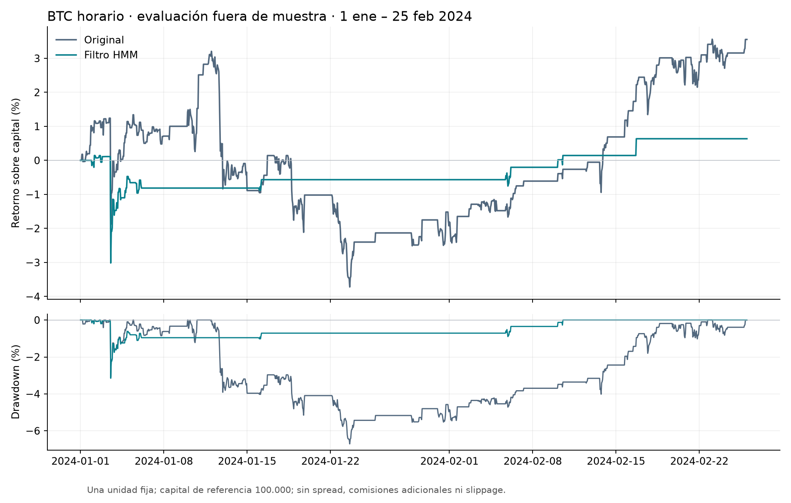

> RESULTADO ANTERIOR: utilizaba cierres semanales. No describe la evaluación corregida.

# Resultado ejecutado: BTC horario, ocho semanas fuera de muestra

**El filtro redujo el drawdown, pero también redujo la rentabilidad y el Sharpe. Esta prueba no justifica activarlo por defecto.** La configuración sigue desactivada por defecto; no se ajustaron estados, umbrales, medias ni reglas de salida usando estos resultados.

Se descargaron con `uv` y el loader oficial de Quantiacs **18.978 velas horarias**, desde 2021-12-27 hasta 2024-02-25 23:00 UTC. La evaluación comprende 2024-01-01–2024-02-25, con el último cierre disponible a 2024-02-26 00:00. Las ocho semanas de evaluación no se superponen.

Supuestos comunes: una unidad de BTC por operación, capital de referencia 100.000, sin spread, comisión adicional ni slippage, ejecución al mismo cierre y liquidación semanal del original. Estos resultados son netos de los costos configurados, que en esta ejecución son **cero**. No son una estimación de rentabilidad después de costos reales de un exchange.

## Comparación A/B

| Métrica | Original | HMM 3 estados / 0,70 |
|---|---:|---:|
| Retorno total | 3,554% | 0,636% |
| Retorno anualizado | 25,581% | 4,222% |
| Máximo drawdown, a cierres horarios | −6,710% | −3,154% |
| Sharpe diario anualizado | 1,660 | 0,802 |
| Profit factor, P&L monetario | 1,252 | 1,165 |
| Win rate | 72,115% | 60,714% |
| Operaciones | 104 | 28 |
| Exposición temporal | 38,616% | 4,464% |
| Retorno porcentual medio por operación | 0,0710% | 0,0522% |
| P&L neto en unidades monetarias | 3.554 | 636 |
| Entradas originales | 104 | 104 |
| Entradas aceptadas | 104 | 28 |
| Entradas rechazadas | 0 | 76 |
| Tasa de aceptación | 100% | 26,923% |
| P(favorable) media a la entrada | 30,347% | 95,580% |

El retorno anualizado extrapola sólo 56 días y no debe interpretarse como una previsión anual. Las probabilidades del original se registran para comparación, pero no afectan sus entradas.

Se rechazó el **73,077%** de las entradas: 45 por probabilidad inferior al umbral y 31 porque no había estados económicamente habilitados. No hubo rechazos por HMM inválido en estas ocho semanas: los ocho modelos de B convergieron y superaron los controles.

La magnitud del drawdown cayó aproximadamente **52,99%**, pero la exposición cayó **88,44%** y el retorno total **82,10%**. El Sharpe también empeoró. La menor caída de equity no demuestra por sí sola una mejor identificación económica de reversión; mantener mucho más tiempo efectivo explica parte importante del cambio de riesgo.

Valores completos: [comparison.csv](results/btc_ab_weekly_legacy/comparison.csv), [decisiones](results/btc_ab_weekly_legacy/hmm_decisions.csv), [trades originales](results/btc_ab_weekly_legacy/original_trades.csv) y [trades filtrados](results/btc_ab_weekly_legacy/hmm_trades.csv).

## Ventanas y estados habilitados

El número de estado es **local a cada modelo**. No se debe interpretar el estado 1 de dos semanas como un mismo régimen.

| Inicio de test | Media / candle / lookback | Estados favorables históricos | Trades original → HMM | P&L original → HMM |
|---|---|---|---:|---:|
| 2024-01-01 | TEMA / H1 / 2 | 1 | 46 → 23 | 713 → −814 |
| 2024-01-08 | WMA / H1 / 40 | ninguno | 9 → 0 | −1.600 → 0 |
| 2024-01-15 | KAMA / H1 / 33 | 1 | 5 → 1 | −132 → 247 |
| 2024-01-22 | KAMA / H1 / 40 | ninguno | 4 → 0 | −1.469 → 0 |
| 2024-01-29 | WMA / H1 / 40 | ninguno | 10 → 0 | 1.010 → 0 |
| 2024-02-05 | KAMA / H1 / 40 | 1 | 7 → 3 | 1.216 → 711 |
| 2024-02-12 | KAMA / H1 / 36 | 2 | 15 → 1 | 3.275 → 492 |
| 2024-02-19 | WMA / H1 / 40 | ninguno | 8 → 0 | 541 → 0 |

La distribución de las 28 entradas aceptadas, conservando la identidad del modelo, es: `(ventana 0, estado 1): 23`, `(ventana 2, estado 1): 1`, `(ventana 5, estado 1): 3`, `(ventana 6, estado 2): 1`. El conteo global por ID del CSV no debe usarse como clasificación económica estable entre ventanas.

Los estados habilitados cumplieron estos criterios **antes** de cada test:

| Ventana / estado | Trades de calibración | Esperanza neta media | Límite inferior bootstrap |
|---|---:|---:|---:|
| 0 / 1 | 718 | 0,0795% | 0,0264% |
| 2 / 1 | 144 | 0,3326% | 0,2056% |
| 5 / 1 | 137 | 0,3273% | 0,0772% |
| 6 / 2 | 44 | 0,3503% | 0,1776% |

La primera ventana demuestra la limitación: evidencia positiva en calibración no impidió un P&L de −814 en sus 23 operaciones aceptadas fuera de muestra. Las otras tres ventanas operadas cerraron positivas, pero con sólo 1, 3 y 1 operaciones. Cuatro ventanas se abstuvieron por completo. No hay muestra fuera de muestra suficiente para afirmar una ventaja estable por estado.

Datos completos de esta sección: [window_comparison.csv](results/btc_ab_weekly_legacy/window_comparison.csv) y [regime_selection.csv](results/btc_ab_weekly_legacy/regime_selection.csv).

## Qué distinguió a los estados

Ejemplo del primer modelo, sobre su calibración histórica. Las variables se promedian en todas las observaciones asignadas al estado, no sólo en las entradas. Distancia y pendiente se expresan en unidades logarítmicas; RV es la raíz de la suma de retornos logarítmicos al cuadrado durante 20 horas, sin anualizar.

| Estado | Frecuencia | Duración media (h) | Permanencia estimada | Distancia media | Pendiente MA media/h | RV media | ER medio | Decisión económica |
|---|---:|---:|---:|---:|---:|---:|---:|---|
| 0 | 12,283% | 1,19 | 18,287% | +0,000292 | +0,000458 | 0,028979 | 0,3454 | Sólo 6 trades: muestra insuficiente |
| 1 | 13,255% | 1,27 | 21,921% | −0,000276 | +0,000293 | 0,029230 | 0,3440 | 718 trades y límite inferior positivo |
| 2 | 74,210% | 17,38 | 93,448% | +0,000001 | +0,000016 | 0,013228 | 0,1854 | 1.932 trades; límite inferior negativo |

En ese modelo, el estado 1 agrupó desviaciones negativas breves respecto a una TEMA muy rápida, con volatilidad relativamente alta. El estado 2 fue más persistente y menos volátil; su expectativa puntual era positiva, pero el intervalo conservador no permitió habilitarlo. No se asignaron de antemano etiquetas como «reversión», «tendencia» o «volatilidad» a los IDs.

Los modelos KAMA encontraron agrupaciones distintas: los estados habilitados de ventanas 2, 5 y 6 duraron en promedio 10,81, 11,29 y 10,10 horas en calibración, con RV 0,01845, 0,01791 y 0,01720 y ER alrededor de 0,21. No equivalen al estado 1 de TEMA. Una distancia media positiva en el conjunto de un estado tampoco contradice una entrada concreta bajo la media.

Las frecuencias no suman exactamente 100% cuando hay observaciones inválidas. Se identificaron seis velas fuente ausentes: 2022-10-12 08:00–11:00 y 2023-03-06 10:00–11:00 UTC. Las ventanas de features afectadas se invalidaron sin interpolar precios.

El archivo [regimes.csv](results/btc_ab_weekly_legacy/regimes.csv) contiene **todos** los estados de **todas** las ventanas, incluyendo probabilidades medias, duración, volatilidad, distancia, pendiente, ER, retornos futuros descriptivos, señales y estadísticas de trades; separa `fit_descriptive`, `calibration` y `evaluation`.

## Sensibilidad C/D

Se ejecutaron 120 filas de sensibilidad: ocho ventanas × tres cantidades de estados × cinco umbrales (incluye el umbral fijo 0,70). La primera mitad de cada calibración seleccionó estados; la segunda evaluó los umbrales. No se usaron resultados de test para elegir una configuración ni se reemplazó B.

| Estados | Filas de sensibilidad | Filas con ≥30 trades en validación de calibración |
|---|---:|---:|
| 2 | 40 | 5 |
| 3 | 40 | 15 |
| 4 | 40 | 17 |

En 83 de las 120 combinaciones ventana/configuración no hubo siquiera 30 trades en esa mitad de validación. Los modelos ajustaron estadísticamente, pero eso no garantiza una muestra económica suficiente. Las calibraciones de distintas ventanas se solapan: **no sumar sus P&L como si fueran una cartera ni considerarlas muestras independientes**. No se proclama una configuración ganadora a partir de esta tabla.

Resultados individuales: [calibration_sensitivity.csv](results/btc_ab_weekly_legacy/calibration_sensitivity.csv).

## Verificación y alcance

- **34 tests aprobados**, 0 fallos, 0 errores y 0 omitidos; [JUnit](results/weekly_legacy_tests.xml).
- Se comprobó además sobre los resultados reales que las 28 operaciones HMM son un subconjunto exacto de las originales, con los mismos precios y fechas de salida, y que equity final menos capital coincide con el P&L de los trades.
- Todas las posiciones fueron LONG o efectivo. Se verificaron fronteras históricas, hashes de código/datos y reproducción exacta de probabilidades/trades de la primera ventana en dos ajustes independientes.
- No se modificaron fuentes originales, rama, commits, reglas de salida ni función objetivo del optimizador. Los cambios están en esta carpeta.

Trazabilidad: [manifest.json](results/btc_ab_weekly_legacy/manifest.json), [procedencia de datos](results/btc_ab_weekly_legacy/data_source.json), [verificación adicional](results/btc_ab_weekly_legacy/verification.json), [log de ejecución](results/weekly_legacy_run.log).

La comparación es causal bajo los supuestos documentados, pero sus conclusiones se limitan a esta media seleccionada con bloques temporales separados, este activo, este período y ejecución sin costos adicionales. El menor drawdown se mantuvo en el agregado fuera de muestra; la mejora de rentabilidad no ocurrió. La caída del Sharpe y el escaso número de trades filtrados no respaldan una recomendación de activar el filtro. El siguiente estudio tendría que fijar de antemano otro período no utilizado, costos ejecutables y criterios de éxito, manteniendo esta evaluación como resultado ya observado.
